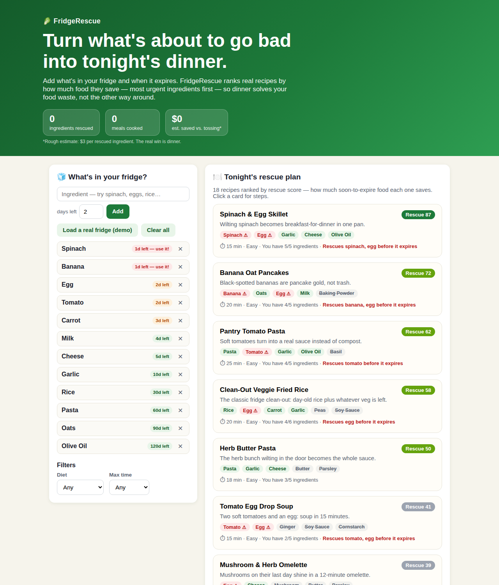

# FridgeRescue 🥬

**Turn what's about to go bad into tonight's dinner.**

FridgeRescue is a small, honest web app that answers the most expensive question in every kitchen — *"what can I make with what I already have, before it goes off?"* — and ranks the answer by how much food it saves.



## The problem

Households throw away a startling share of the food they buy — not because they don't care, but because dinner planning starts from a recipe ("what do I feel like?") instead of from the fridge ("what's about to expire?"). Spinach wilts behind the milk, bananas blacken on the counter, and the fix — searching five recipe sites and cross-checking ingredients by hand — takes longer than just ordering takeout. The waste is a planning failure, not a cooking failure.

## Who it helps

- **Busy households and students** cooking on a budget, who buy fresh food with good intentions and lose the race against the expiry date.
- **Anyone cooking for one**, where a whole bunch of herbs or a full bag of carrots is always too much for a single meal.
- **Food-waste-conscious cooks** who want a system, not a guilt trip.

## What it does

1. **Tell it your fridge.** Add ingredients and how many days each has left. One tap loads a realistic demo fridge. Expiry badges sort your food by urgency — red means *use it today*.
2. **Get a rescue plan.** 18 built-in, real recipes are matched against your fridge and ranked by a transparent **Rescue Score**: mostly ingredient coverage, boosted by how soon the ingredients it uses would expire, with a small nudge for quick recipes. Every card shows exactly what you have, what you're missing, and which expiring items it rescues.
3. **Filter your way.** Vegetarian, vegan, or gluten-free; 15/20/30-minute caps.
4. **Cook with a checklist.** Click a recipe for steps, a have/need chip list (your shopping list is just the "need" chips), and an *"I cooked this"* button that clears the used ingredients from your fridge.
5. **See your impact.** A running counter tracks ingredients rescued and meals cooked, with a rough dollars-saved estimate. Your fridge persists between visits (localStorage) — no account, ever.

Everything runs locally. No network calls, no tracking, no API keys. The matching is deterministic and explainable — the score formula is printed in the footer of the app itself.

## Setup

Requirements: Node.js 18 or newer. There are **no dependencies to install**.

```bash
git clone <this repo>
cd wave1-nextspark   # (repo folder name may vary)
node server.js
# → FridgeRescue running at http://localhost:4173
```

Open http://localhost:4173 in a browser. To use a different port: `PORT=8080 node server.js`.

Health check: `curl http://localhost:4173/health` → `{"ok":true,"app":"fridgerescue","version":"1.0.0"}`

## Tests

```bash
npm test
```

Eight zero-dependency tests (`node:test`) cover the recipe database, the matching/urgency engine, diet and time filters, the HTTP server (including a path-traversal check), and the presence of the submission files.

## How it's built

- **Zero-dependency Node.js server** (`server.js`, ~45 lines, stdlib `http`/`fs` only) serving the static app, with a `/health` endpoint and path-traversal protection.
- **Vanilla HTML/CSS/JS front end** — no framework, no build step. Responsive grid layout, native `<dialog>` for the recipe view.
- **Shared matching engine** (`public/recipes.js`): one module that runs in the browser *and* in Node, so the exact logic judges see is the exact logic the tests exercise. It handles ingredient synonyms/plurals ("eggs" → "egg", "cheddar" → "cheese"), urgency weighting (food expiring today is worth ~6× more to use than shelf-stable food), diet/time filters, and score explanation data.
- **localStorage persistence** for the pantry and impact counters.

## Built with

- Node.js (stdlib only — zero npm dependencies)
- Vanilla HTML, CSS, JavaScript
- localStorage (browser)
- AI assistance: Muse (Anthropic) agent fleet — see the disclosure below

## Credits

- Recipe selection, matching design, code, tests, and documentation: built by AI agents during the NextSpark Hacks submission period (see disclosure).
- Problem selection, theme fit, and acceptance review: Rene Turcios.
- Recipes are classic home-cooking staples written for this project; no third-party recipe content was copied.
- No third-party code, libraries, or assets are used — the dependency list is intentionally empty.

## AI assistance

As the NextSpark Hacks rules ask, here is exactly what was human and what was generated:

- **Rene Turcios (human):** chose the problem (household food waste), chose the hackathon/theme fit, set the constraints (zero-dependency, completable, polished), and performed acceptance review of the finished app.
- **AI agents (Tree / Muse fleet):** designed the matching engine and scoring formula, wrote all application code, the recipe database content, the tests, the screenshot, and this documentation during the hackathon submission period.
- **At runtime, the app itself uses no AI and no external APIs** — matching is a deterministic local algorithm, which is deliberate: it works offline, it's explainable to judges, and it never hallucinates a recipe.

## Build Disclosure

Build Disclosure: AI-built. This project was built by AI agents (Tree / Muse fleet) directed by Rene Turcios. Rene set the problem, theme fit, and acceptance review; agents designed, coded, tested, and documented the project during the hackathon period. AI tools used are credited in the Built With list.

## License

MIT — see [LICENSE](LICENSE).
